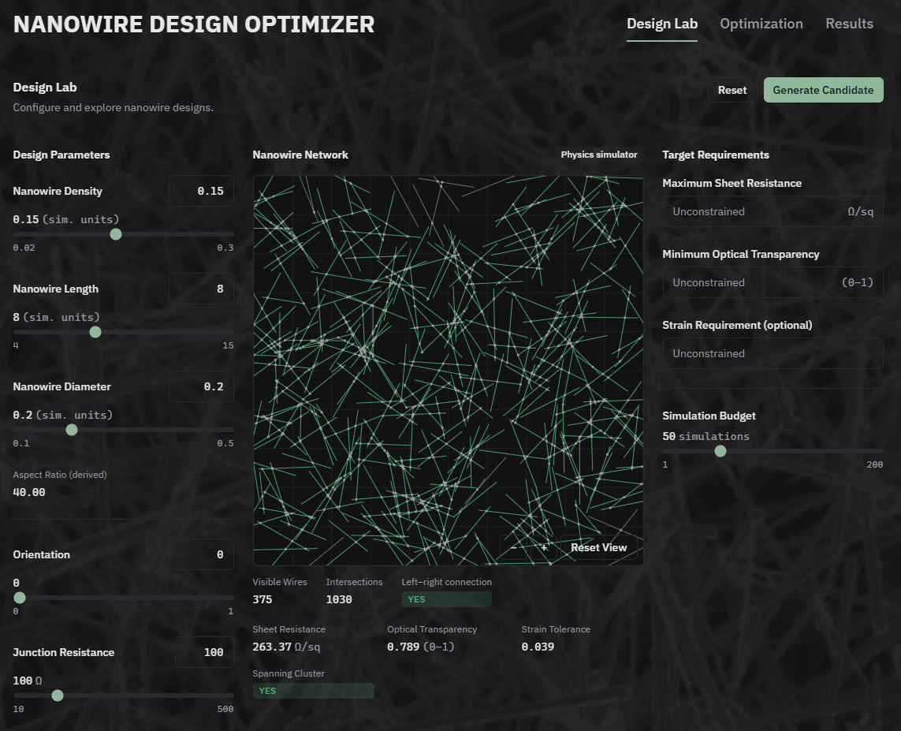
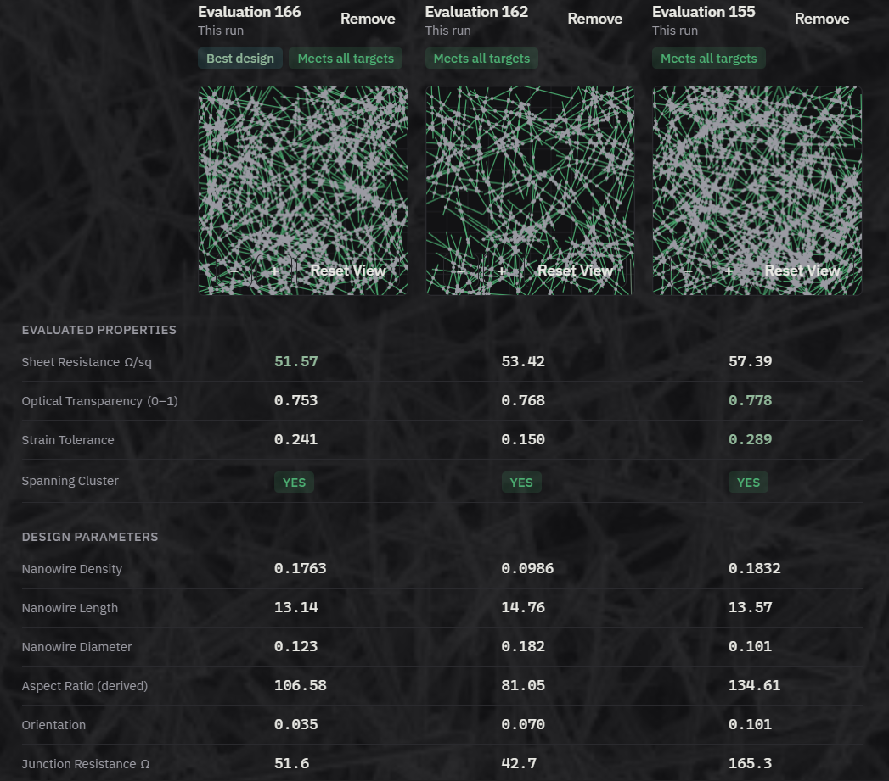

# ML-Driven Inverse Design of Nanowire Networks

An ML-assisted framework for designing transparent and flexible conducting electrodes using physics-based simulations and Bayesian Optimization.

## Overview

Designing nanowire networks for transparent conducting electrodes involves balancing two competing properties: electrical conductivity and optical transparency.

Increasing nanowire density generally improves electrical connectivity and reduces sheet resistance, but also reduces optical transparency.

This project addresses this design challenge through a physics-guided inverse-design framework that combines nanowire network simulation with Machine Learning.

The system uses a Gaussian Process surrogate model and Bayesian Optimization to identify promising nanowire configurations while reducing reliance on expensive physics simulations.

## Key Features

- **Nanowire Network Generation:** Generate network configurations using user-defined design parameters.
- **Connectivity Analysis:** Detect nanowire intersections, construct graph representations, and identify connected and percolating pathways.
- **Electrical Modeling:** Model the network as an interconnected resistor system and calculate effective sheet resistance.
- **Optical Modeling:** Estimate optical transparency based on network geometry and coverage.
- **Gaussian Process Surrogate:** Predict network properties and estimate uncertainty using previously simulated designs.
- **Bayesian Optimization:** Intelligently select promising candidate designs using exploration and exploitation.
- **Interactive Web Application:** Configure designs, visualize networks, run optimization, and inspect results through a unified interface.

## Methodology

The project follows an iterative physics-guided optimization workflow:

1. **Design Configuration:** Define nanowire parameters such as density, length, diameter, orientation, and junction resistance.
2. **Network Generation:** Generate a nanowire network based on the selected parameters.
3. **Connectivity Analysis:** Detect intersections and construct a graph representation to analyze network connectivity.
4. **Physics Simulation:** Evaluate electrical and optical properties, including sheet resistance and transparency.
5. **Surrogate Modeling:** Train a Gaussian Process using the accumulated simulation data.
6. **Bayesian Optimization:** Select the next candidate using predicted performance and uncertainty.
7. **Model Update:** Simulate the selected candidate, add its results to the dataset, and update the surrogate model.

The process repeats until the available simulation budget is exhausted.

## Optimization Approach

The optimization engine consists of two main components:

**Gaussian Process (GP)**

- Learns the relationship between design parameters and simulated properties.
- Provides performance predictions.
- Estimates uncertainty in its predictions.

**Bayesian Optimization (BO)**

- Uses GP predictions and uncertainty to select new candidates.
- Balances exploration of uncertain regions with exploitation of promising regions.
- Updates the model using newly obtained simulation results.

This allows the system to make informed design selections instead of relying entirely on random sampling.

## Technology Stack

| Component | Technologies |
|---|---|
| Frontend | React, TypeScript, Tailwind CSS, Vite |
| Backend | Python, FastAPI |
| Scientific Computing | Numpy, Pandas, Scipy, Matplotlib |
| Network Analysis | Networkx |
| Machine Learning | Sklearn |

## Application

The project includes an interactive web application called **Nanowire Design Optimizer**.

Its main sections include:

- **Design Lab:** Configure nanowire parameters and target requirements.
- **Network Visualization:** View generated nanowire configurations.
- **Optimization:** Initiate and monitor Bayesian Optimization runs.
- **Results:** Explore evaluated candidates, compare their properties, and inspect the best-performing design.



## Project Structure

```text
project-root/
│
├── frontend/                   # frontend
│   └── src/
│       ├── assets/
│       ├── components/
│       ├── context/
│       ├── hooks/
│       ├── lib/
│       └── pages/
│   ├── App.tsx
│   ├── index.css
│   ├── main.tsx
│   └── package.json
│
├── src/                       # backend
│   ├── bayesian_optimizer.py
│   ├── design_finder.py
│   └── ...
├── app.py
├── requirements.txt
└── README.md
```

## Installation and Setup

### Prerequisites

- Python (latest)
- Node.js (latest)
- npm

### 1. Clone the repository

```bash
git clone https://github.com/unknowndx1651/Nanowire-Inverse-Design.git
cd Nanowire-Inverse-Design
```

### 2. Set up the backend

```bash
cd backend

python -m venv venv
```

Activate the virtual environment:

Windows:
```bash
venv\Scripts\activate
```

Linux/macOS:
```bash
source venv/bin/activate
```

Install dependencies:

```bash
pip install -r requirements.txt
```

Start the backend:

```bash
python -m uvicorn app:app --reload
```

### 3. Set up the frontend

Open another terminal:

```bash
cd frontend
npm install
```

Configure the backend API URL in the appropriate environment file:

```env
VITE_API_BASE_URL=[BACKEND_URL]
```

Start the development server:

```bash
npm run dev
```

Access the application at: (Provided in terminal)

```text
[FRONTEND_LOCAL_URL] 
```

## Results and Evaluation

The system evaluates candidate nanowire configurations based on their simulated electrical and optical properties.

The results interface provides:

- Evaluated nanowire configurations.
- Sheet resistance and optical transparency.
- Design parameter comparisons.
- Best-performing candidate identification.
- Optimization history and performance visualization.




## Limitations and Future Work

**Current Limitations**

- Results depend on the assumptions and approximations used in the computational models.
- Experimental fabrication and physical validation have not been performed.
- Optimization performance depends on the selected design space and surrogate model.

**Future Work**

- Experimental validation of optimized nanowire configurations.
- Improvements to electrical and mechanical modeling.
- Exploration of additional nanowire materials and configurations.
- Investigation of more advanced optimization strategies.

## Team

Name : Shah Daksh Akhil (24115132)

**Course:** Nanotechnology for Industry 4.0 (NTO-102)  
**Institution:** Indian Institute of Technology Roorkee

## Acknowledgements

Developed as part of the Nanotechnology for Industry 4.0 course project at IIT Roorkee.

